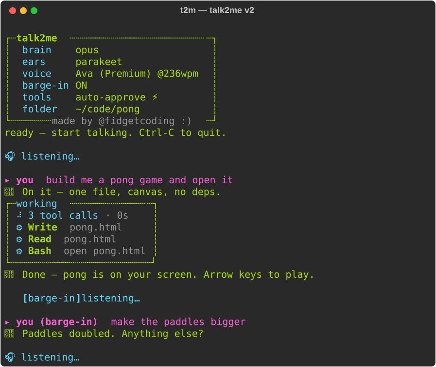

# How talk2me got built

My words are quoted as I wrote or said them, typos fixed, nothing else. Commit hashes and tags are from this repo, and times are US Eastern. "Private note" means a dated record I keep offline: session notes and the transcripts talk2me saved of my own voice sessions.

## 1. The short version

On May 22, 2026, I had Claude Code build a voice loop around itself. It drove a headless Claude Code session over its streaming JSON mode, so it could speak the answer and nothing else. It passed every headless test, and nobody spoke to it for eight weeks.

On the night of July 18 I said "let's finish talk2me." By 2 AM it had spoken tool approvals, barge-in, GPU ears and its first real conversations, including a pong game built by voice. The repo went public that night.

Then came the echo war. You can cut in on headphones, because the mic never hears the voice. On open laptop speakers the mic hears everything, including talk2me itself, and every way I tried to tell its voice from mine failed in the field. Voice-lock (v2.3) locked me out of my own mic. An echo gate (v2.4) got to zero false cuts, but it couldn't hear me over itself near max volume. A bass trick died because MacBook Pro woofers play bass. I rolled public `main` back to v2.2.0 and said why in the README. About 21 hours later, macOS's own echo canceller, the one FaceTime uses, made its voice invisible to the transcriber, and v2.5.0 shipped.

On November 1 I fixed what an audit was right about: voice stopped auto-approving tools (v2.6.0). Then I went after my own list of things I'd never proven, and found the biggest thing I'd gotten wrong. Voice-lock hadn't failed because laptop mics are bad. I'd been feeding the speaker model the wrong input. That fix, and everything else since v2.6.0, is on `main` and not tagged yet.

## 2. Origin, in my words

From the README:

> "I live in Claude Code. All day, in the terminal, sometimes from my phone on the couch over SSH."

> "I already had half of a voice workflow: Wispr Flow gives me dictation, so my words get in fine. What I never had was the other half."

> "I'd dictate a prompt, then sit there reading a wall of text like it's 1997."

> "Nobody had built that for a terminal coding agent without scraping the screen like a raccoon going through a dumpster. So here we are."

Every turn was hit Fn, talk, release, wait, read the output, hit Fn again. I wanted turn-taking: it listens, the agent talks back, the mic reopens, no buttons. On May 22 I added the requirement that first put echo on the table (private note):

> "I definitely need it to work with headphones, Bluetooth, etc."

And on the night it came alive, July 18 to 19 (private notes):

> "let's finish talk2me."

> "drastically reduce that downtime"

> "everything is working basically perfectly. I'm really happy with the result."

## 3. Timeline

| Date (2026) | What happened | Evidence |
|---|---|---|
| May 22 | Half-duplex loop over Claude Code's stream-json mode. The mic mutes while it talks | `dd2c8df` |
| May 22 | Silero VAD, Kitten TTS, session persistence, a security audit, every finding fixed | `29336e0`, `7b4fcdb`, `6bf634f` |
| May 22 | webrtc VAD, separate input and output devices for Bluetooth | `a6f03e0` |
| Jun 12 | Bug-hunt sweep | `2943d27` |
| Jul 18 | Spoken approvals, barge-in on headphones, first green CI | `06200a3`, `2c53cbc`, `34a1c07` |
| Jul 18 | First live mic session passes on default settings | Private note |
| Jul 18 | Barge-in crash fixed, Parakeet ears, latency batch, sustained onset | `834a637`, `d3bc338`, `81c41e7`, `8beeea3` |
| Jul 19 | Installer and hook mode. Barge-in switches itself off on speakers | `1a9d98a`, `390c111` |
| Jul 19 | Auto-approve becomes the default. Phantom-loop cause found, voice pause added | `8712038`, `f25e30b` |
| Jul 19 | Repo goes public. Cheat sheet | Private note, `f5f52aa` |
| Jul 19 | v1.0.0 stamped and frozen on a `v1` branch. v2.0.0, the retro face | `4e39d7d`, `5320383` |
| Jul 19 | Speech classifier, setup wizard, phone mode. v2.1.0 | `6bd4e6f`, `f7f5024`, `82841ee`, `19e6bf1` |
| Jul 19 | Ears stay open while it codes, `--continue`, Codex brain. v2.2.0 | `d912cec`, `04bfbb9`, `7fa0239`, `207e056` |
| Jul 19 | Speakers mode becomes "gaps only" | `d59c10a` |
| Jul 19 | Voice-lock v2.3.0, owner lockout fixed in v2.3.1, talk-over through voice-lock, then observe-only | `6eeb35f`, `aeb7fee`, `ff9c330`, `c6854c5` |
| Jul 19 | Echo gate (v2.4.0, never tagged) and six live fixes | `04550c3`, `2d7319a`, `48214fa`, `50f6d9f`, `dd60b85`, `624e7e1`, `2ca98cf` |
| Jul 20 | Max-volume field run: zero false cuts, talk-over buried | `0ca1778` |
| Jul 20 | Low-band channel built, then killed by field data | `5434b9a`, `c0d2db4` |
| Jul 20 | Public `main` rolled back to v2.2.0 | `a7bd5d4`, `296905e` |
| Jul 20 | Native echo cancellation: plan, spike, mic, mode ladder | `e6e3f45`, `1b17d06`, `b5a0beb`, `d6d5df7` |
| Jul 20 | Field rounds: energy VAD under native mode, typed takeover, the ⌨ input line | `68aa2d6`, `cc2877d`, `55c9ec2` |
| Jul 20 | v2.5.0 ships, rollback over | `3085fd9` |
| Aug 17 | Private paths and names scrubbed from docs | `686b4df`, `5ecf51e` |
| Nov 1 | Voice asks before tools, 69-rule denylist, installer pinned to tags | `79d5866`, `6690c50` |
| Nov 1 | GPU Whisper as default ears, reversed 14 minutes later. v2.6.0 | `cc130d2`, `588ad25` |
| Nov 1 | CI fixed for Ubuntu 26.04 | `f66e7e4` |
| Nov 1 | `--sandbox`, commands in five more languages, the dead air out of the voice | `73eff4e`, `e7bcf6a`, `be9a62f` |
| Nov 1 | CI on Windows, the live loop on Linux sound cards, the phone page in real browsers | `6cfa415`, `244cce5`, `10edcf2` |
| Nov 1 | Ears tested on real people. Voice-lock's real bug fixed | `20783fb`, `e6ce7b0` |
| Nov 1 | Clean-clone first run, recovery, long sessions, sandbox hardening | `0bdf843`, `89f8bdf`, `9539853`, `a4347ed`, `50da027` |

## 4. Round by round

The echo war is rounds 5 to 8. Here it is on one screen, every answer I tried to "what happens when the mic can hear the speakers?":

| Try | The idea | What the numbers said | Today |
|---|---|---|---|
| Half-duplex | Mute the mic while it talks | Never cuts itself. You can't cut in either | `--no-barge-in` |
| Headphones | The voice goes to your ears | Works, if you wear them | Plain full duplex |
| Gaps only | On speakers, listen except while it speaks | A long answer can't be interrupted | `--no-aec` |
| Voice-lock (v2.3) | Only my voice can cut | Its voice outscored mine | A filter, fixed on `main` |
| Echo gate (v2.4) | Subtract what it's playing | Zero false cuts, talk-over buried at max | Fallback layer |
| Low band | Laptop speakers can't play bass | MacBook Pro woofers can | Telemetry only |
| Native AEC (v2.5) | macOS cancels its own output | The transcriber hears nothing | Default on a Mac |

### Round 1: the spine (May 22, plus June 12)

- **Built:** a half-duplex loop that drives Claude Code headless over its stream-json mode (`dd2c8df`). One long-lived process is one conversation. My words go in on stdin, clean events come out, and only the answer's prose gets spoken. The mic mutes while it talks, which was the first answer to echo: never listen while you're talking. Then Silero VAD, Kitten TTS and session persistence, a security audit of the whole thing (`docs/security-audit.md`), a fix for every finding (`6bf634f`), webrtc VAD and separate input and output devices (`a6f03e0`), and a June bug hunt (`2943d27`).
- **Tested:** headless only, with fakes replaying WAV files and a fake agent. 7 of 7 suites passed (private note). Nobody spoke to it.
- **Broke:** the first spine run sat there in silence. Claude Code doesn't announce it's ready until it has input, and I was waiting for it to announce it was ready (private note). The Bluetooth trap: opening a Bluetooth headset's mic drops the whole headset into telephone quality.
- **Fixed:** send the first turn right away. Pick input and output separately, so you keep good sound in your ears and use the laptop mic.
- **Wanted next:** headphones and Bluetooth, my hard requirement. Headphones were also the first real echo insight: if the voice goes into your ears, the mic never hears it, and you can talk over it with no echo canceller at all. Then it sat for eight weeks.

### Round 2: first words (July 18)

- **Built:** spoken approve and deny over the CLI's stdio permission wire, pinned byte by byte against CLI 2.1.214 (`06200a3`, [`docs/permission-spike-results.md`](docs/permission-spike-results.md)). The same spike found an interrupt request that really cancels the agent's generation and keeps the session alive. That made barge-in possible (`2c53cbc`), headphones required.
- **Tested:** CI went green for the first time, on Python 3.11, 3.12 and 3.13 plus ruff (`34a1c07`). The first live mic session, around 10:20 PM on my MacBook's own mic and speakers, passed on default settings, and a spoken "approve" wrote a file to my Desktop (private note).
- **Broke:** the first live barge-in crashed. `stop()` closed the output stream under a write still running on another thread (PortAudio error -9986). First words got clipped, because the energy VAD notices you a beat late.
- **Fixed:** abort during play with a deferred close, and 300 ms of pre-roll (`834a637`).
- **Wanted next:** speed. My note to Claude: "drastically reduce that downtime."

### Round 3: speed, noise and manners (July 18 to 19, overnight)

- **Built:** better ears for jargon (hotwords, plus live seeding: identifiers from the agent's last reply become bias terms, because they're what you'll say back) (`d2be58a`). Parakeet on the Apple GPU (`d3bc338`). A latency batch: the agent loads only project config, a short spoken-reply persona, warm ears before the mic opens, and speech that starts at the first clause (`81c41e7`). Holding the turn when a sentence sounds unfinished (`17266ca`). A render and play pipeline (`fa65149`). The installer, the `t2m` command and hook mode (`1a9d98a`).
- **Echo answer:** adaptive duplex (`390c111`). Sound follows whatever macOS is routed to, and on open speakers barge-in switches itself off instead of cutting every answer on its own echo.
- **Tested:** loading only project config took time to first token on a trivial prompt from 3.14 s to 1.39 s. Whisper took 0.32 to 0.41 s an utterance and Parakeet 0.11 to 0.26 s, and Parakeet got "orchestrator.py" right word for word (private note). Live, I had it count to fifty and cut it off mid-count, built pong by voice, built a platformer by voice, and reported a fall-through-the-floor bug by voice and had it fixed (private note).
- **Broke:** 250 ms onsets fired on nothing. One ate a question, one cut playback at the first word (`8beeea3`). A 20 second rant got collected as one interruption (`a0c5eb2`). Then phantom turns: "Okay" 26 times in a row during silence. The theory was audio bleed, and I said no, I was wearing headphones. The real cause: fan hum tripped the energy VAD, and Whisper hallucinated on it, biased toward the agent's own words by the live seeding (`f25e30b`).
- **Fixed:** a 450 ms sustained onset, a 10 second cap, a hallucination gate, stutter collapse, and voice pause and wake.
- **Also:** auto-approve became the default (`8712038`), because approving every file write out loud was unusable live. Round 9 reverses that.
- **Wanted next:** nothing. "Everything is working basically perfectly. I'm really happy with the result." I flipped the repo public around 1:45 AM.

### Round 4: launch, and the v2 face (July 19)

- **Built:** the cheat sheet (`f5f52aa`). v1.0.0, stamped and frozen on its own branch (`4e39d7d`), so the installer can always get it back. The retro face, behind a renderer seam with snapshot tests that pin the plain output byte for byte, with a live work panel and code cards (v2.0.0, `5320383`). Barge-in on by default (`898a714`). A real speech classifier in front of everything (`6bd4e6f`). The setup wizard (`f7f5024`). Phone mode, with the iPhone's own echo cancellation doing the work (`82841ee`). v2.1.0 (`19e6bf1`). Ears that reopen in every tool and thinking gap (`d912cec`), `--continue` and a spoken session picker (`04bfbb9`, `115c9dd`), Codex as a second brain (`7fa0239`). v2.2.0 (`207e056`).
- **Echo answer:** "gaps only" on speakers (`d59c10a`). The ears stay hot everywhere except while its own voice is physically playing.
- **Tested:** CI green on the v2.0.0 and v2.2.0 commits (runs 29699308718, 29707294366). After the classifier, three clicks in two seconds of silence transcribed to nothing (private note). Codex recalled a planted word across `--continue` through the real CLI (private note).
- **Broke:** typing, taps and coughs fired turns and cut the agent off. And the ears went deaf for whole build turns. In my words, it "completely stops listening while it codes" (private note).
- **Fixed:** the classifier gate, and ears that reopen in every gap.
- **Wanted next:** I called v2.2.0 done: "the current version literally works perfectly." Except on open speakers, a long answer with no gaps couldn't be interrupted at all. That's where the war starts.

### Round 5: voice-lock (July 19, 8 to 10 PM)

- **Built:** speaker verification, fully local, with a 28 MB CAM++ model in ONNX (`6eeb35f`, v2.3.0). Enroll once and the mic answers to you. The echo plan: with a healthy voiceprint, stay full duplex on speakers, because its own voice coming off the speaker fails the check, so only you can cut it (`ff9c330`).
- **Tested:** in the test suite, a new sentence in the enrolled voice scored +0.81 and the hardest impostor voice +0.73, under a calibrated bar of 0.797 (`6eeb35f`). Then I enrolled for real.
- **Broke:** my own clips scored 0.51 to 0.64, below the agent's own voice at 0.585 to 0.65. The bar landed above everything I said, and it locked me out of my own mic (`aeb7fee`). Third enrollment: its voice 0.785 to 0.854, mine 0.72 to 0.86 (`c6854c5`). Live, my voice scored 0.17 to 0.63 against my own print, and a video scored 0.24 ([AEC plan](docs/v2.5-aec-plan.md)).
- **Fixed:** the owner can never be locked out (v2.3.1, `aeb7fee`), enrollment at varied volumes and speeds (`ff48fc6`), and a weak print only observes and logs scores (`c6854c5`).
- **What I concluded:** that on a laptop mic, your own voice scatters wider than the gap to a stranger's. That was wrong. Round 10 has the real ending.
- **Wanted next:** an answer that doesn't need to know who's talking.

### Round 6: the echo gate (July 19, 10:30 PM to midnight)

- **Built:** the speaker records every block it plays, and the gate asks the mic one question: is there sound here the playback can't explain? It lines the playback up against the mic, fits the gain, and measures what's left over (`04550c3`, the v2.4.0 that never got a tag). Lab fixtures: its own echo left 0.05, a quiet talk-over 0.43, bar at 0.30.
- **Tested and broke, one live round at a time:**
  1. "Count to 30" died at "1". At the start of a sentence the playback record was short and got cut off instead of padded with silence. After the fix: echo 0.048, a real voice 0.66 (`2d7319a`).
  2. A cut froze everything on `[barge-in] listening…`. Stopping the stream on the event loop deadlocked against a write blocked on another thread (`48214fa`).
  3. Same freeze with the stop moved off the loop. On CoreAudio, stopping from another thread can strand that write forever. New rule: cutting playback makes no audio-library call at all, and the sound dies in about 130 ms plus a 100 ms buffer (`50f6d9f`).
  4. It cut itself off between sentences, because the record dropped the pauses. Now it keeps wall-clock time: echo across a pause 0.07, real speech after playback 0.63 (`dd60b85`).
  5. Three self-cuts, all on lively prose ("Physics is the branch of."), never on a monotone count. The mic's automatic gain squashes loud syllables, so one gain can't explain them. Gain per 250 ms segment, plus a backstop that throws away any "interruption" that matches what it just said: warped echo 0.18, a voice over it 0.51 (`624e7e1`).
  6. First real field scores: its own echo at 0.30 and 0.41, about double the lab. Bar to 0.50, two foreign verdicts 300 ms apart before a cut, and a Ctrl-C that kept running fixed (`2ca98cf`).
- **Tested:** at max volume, about 70 echo onsets scored 0.10 to 0.47, with zero false cuts (`0ca1778`). The backstop worked live: it swallowed its own words and resumed the tool run it had interrupted (private note).
- **Broke:** my couch-voice talk-over at max volume scored 0.15 to 0.47, right inside the echo range ([AEC plan](docs/v2.5-aec-plan.md)). Speakers a few inches from the mic drown a normal voice.
- **Wanted next:** something the speakers can't fake.

### Round 7: the low band, and the rollback (July 20, just after midnight)

- **Built:** laptop speakers roll off below about 200 Hz, and a human voice carries energy at 85 to 155 Hz. So real bass while it's playing should mean a person in the room (`5434b9a`). It was needed: at normal volume my talk-over peaked at 0.31 while echo ran to 0.47. Fixtures: a voice with bass over echo 0.53, echo alone 0.12, bar 0.25.
- **Tested:** the next session.
- **Broke:** every false cut in it was the bass vote. A MacBook Pro's woofers put real energy in 70 to 170 Hz: echo scored 0.16 to 0.31 and my talk-over about 0.26 (`c0d2db4`). Third feature, same overlap.
- **Fixed:** the bass channel became telemetry only. Then I asked which version had felt finished. v2.2.0. Public `main` went back to it, with a note in the README saying exactly why (`a7bd5d4`), the v2.3 tags stayed installable, and the work went on in private.
- **What the three failures taught me:** any single number computed from a mic drowning in its own speaker output overlaps with a person talking. The signal has to be cleaned before you measure it. That's an echo canceller's job, and macOS ships one ([AEC plan](docs/v2.5-aec-plan.md), `e6e3f45`).
- **Wanted next:** macOS voice processing.

### Round 8: the canceller FaceTime uses (July 20, 8 to 10 PM)

- **Built:** a written plan the morning after, with a go or no-go gate of about 20 dB of echo removed (`e6e3f45`). A spike on Apple's voice processing through PyObjC (`1b17d06`). A voice-processed mic behind the same mic seam as the old one (`b5a0beb`). A `--aec` ladder: native when its startup probe is healthy, the echo gate as fallback (`d6d5df7`).
- **Tested:** I opened with "I want to finish v2.5.0 of talk2me" and left it running on its own. The dB gate failed, about 4 dB, because the processor's automatic gain pumps up what's left. But the transcriber wrote out the raw echo word for word and got nothing at all from the processed capture, and Silero called 5 of 5 loud raw windows speech and 0 of 5 processed ones. The gate that mattered (can the echo become a turn?) passed. It also cancels everything the Mac plays, so the speaker code didn't change. Then a self-cut check with real speakers, a hot mic and a scripted agent: counting and prose, volume 45 and 100, 0 self-cuts in 4 of 4 runs ([AEC plan](docs/v2.5-aec-plan.md), `c706550`).
- **Broke:** in my field test, webrtc VAD read 60 to 76% of silent frames as voice on the processor's hiss, so turns closed late and one rode the 90 second ceiling. Typing at a busy agent queued up silently. In the spike, switching voice processing on and off about 4 times in one process wedged the mic into digital silence (-180 dBFS).
- **Fixed:** the energy VAD under native mode, which read 0 to 3% on the same captures. An 800 ms close for short commands like "pause" (`68aa2d6`). Typing at a busy agent cuts in like a barge (`cc2877d`). The ⌨ input line (`55c9ec2`). One voice-processing engine per process, reused.
- **Shipped:** the volume sweet spot, measured: four volume-down clicks below max, about 75% (`efefb63`). Then "good for launch!!", and v2.5.0 went out with public `main` current again (`3085fd9`). CI green on it (run 29794945197).
- **Wanted next:** nothing urgent. It sat until November.

### Round 9: better manners, v2.6.0 (November 1)

- **Built:** voice asks out loud before running tools, and a denylist of 69 rules with a rerunnable proof (`79d5866`). An installer that pins to the newest tag (`6690c50`). GPU Whisper (large-v3-turbo) as the default ears (`cc130d2`), then my reversal 14 minutes later: base.en stays the default and nobody gets a new download on first run (`588ad25`, tagged v2.6.0). The ears race, rerunnable (`0098776`).
- **Tested:** the old 8-rule denylist through the real CLI. `rm -fr`, `/bin/rm -rf`, `find -delete`, `python3 -c`, `scp`, `nc`, `/usr/bin/curl` and `git -C . push` all ran (`79d5866`). The race: 24 clips, 8 coding sentences read by 3 synthetic voices, on an M2 Max. base.en 0.46 s with 12.5% word errors, turbo on the CPU 6.17 s and 11.2%, turbo on the GPU about 0.55 s and 13.2%, Parakeet v2 0.11 s and 13.2% (README).
- **Broke:** turbo's no-speech detector read 0.0 on silence through MLX, so it answered silence with "Thank you." 3 of 24 clips lost their closing punctuation, which the hold logic reads as trailing off (`cc130d2`). CI on the v2.6.0 commit failed too: GitHub's Ubuntu moved to 26.04, whose PortAudio won't start without a PulseAudio server, and ruff's newer rules flagged style (run 41289414958).
- **Fixed:** a Silero pass before turbo and a base prompt. CI now starts a silent PulseAudio server and pins ruff (`f66e7e4`, `6cd7567`), green again (run 41291720102).
- **Auto-approve, in hindsight:** every tag from v1.0.0 through v2.5.0 defaulted voice to auto-approve. The May audit in `docs/` told me not to, and it was right.
- **Wanted next:** the README's own list of things I'd never proven.

### Round 10: my own "isn't proven" list (November 1, on `main`, not tagged)

- **Built:**
  - `--sandbox`, because a denylist reads command lines and a script written to a file walks right past it. The kernel enforces it: `sandbox-exec` on macOS, bubblewrap on Linux. Off by default, because `npm install` and friends then need `--sandbox-allow-host` (`73eff4e`).
  - Voice commands in Spanish, French, German, Italian and Portuguese (`e7bcf6a`).
  - Voice chunks that render side by side, so the default voice stops waiting on itself (`be9a62f`).
  - CI on Windows (`6cfa415`), the live voice loop on Linux virtual sound cards (`244cce5`), and the real phone page in Chromium through a real `ssh -L` tunnel (`10edcf2`).
  - A bench on recordings of real people (`20783fb`), a first run from a clean clone with one plain sentence per problem (`0bdf843`), and recovery that costs a broken part, not the session (`89f8bdf`).
- **Tested:** see section 6. Real people reordered the ears: Parakeet came out best on audiobook sentences and worst on single words, 75.0% right at the spoken gate with 23 false approvals out of 600 unrelated words (`20783fb`). A long session stayed flat: 1,500 turns, and talk2me's own memory held at 62 to 73 KB (`9539853`).
- **Broke:**
  - On Linux, Ctrl-C mid-sentence closed the stream under a running write, and ALSA corrupted the heap (`244cce5`).
  - Windows crashed setting up the terminal on its first keystroke, and couldn't launch the npm-installed `claude` (`6cfa415`).
  - A malformed message or an odd-sized packet hung up on the phone (`10edcf2`).
  - My first sandbox hid the keychain files, so a Mac subscription login looked logged out inside it (`1133134`). Nastier scripts found more ways out, like writing to `~/.claude.json` or typing into the waiting shell (`a4347ed`).
  - A pulled headset hung the session for good, and one malformed line from the agent ended it (`89f8bdf`).
- **Fixed:** all of those, each in the commit named.

**The voice-lock ending.** I measured voice-lock on recordings of real people for the first time: 40 LibriSpeech speakers, each enrolled through the real enrollment path. The numbers were terrible, and that's what cracked it. The speaker model expects mean-normalized features. The first voice-lock commit (`6eeb35f`) left that out, after a spike the same day wrongly concluded normalizing "inverted its metric". The bug was never laptop mics. It was mine, and `e6ce7b0` fixes it.

| 40 real speakers, from files | Before | After |
|---|---|---|
| Simulated laptop room: speakers it enforces for | 4 | 39 |
| Simulated laptop room: strangers let in | 93.5% | 6.3% |
| Simulated laptop room: equal-error rate | 34.0% | 5.2% |
| Simulated laptop room: owner rejected | 2.7% | 9.2% |
| Clean recordings: speakers it enforces for | 5 | 40 |
| Clean recordings: strangers let in | 91.5% | 2.2% |
| Clean recordings: equal-error rate | 21.0% | 1.1% |
| Clean recordings: owner rejected | 1.0% | 0.5% |

The bench is `tests/manual_voicelock_bench.py`, with the other 39 speakers as the strangers. The laptop room is a simulation: synthetic room echo, a laptop-like frequency response, fan-like noise and a random level. "Before" looks generous, because a speaker who falls back to observing counts as accepting everyone. Most owner rejections in the laptop room are on the shortest clips, and anything under 0.8 seconds always passes. Old voiceprints keep their old recipe and each launch says to re-enroll. It's a filter, and it hasn't heard a real voice through a real mic since the fix.

## 5. Feature family tree

```
"hit Fn, talk, release, wait, read, hit Fn again"
└─ drive the agent's stream-json, never scrape the screen (the spine)
   ├─ spoken approvals → permission wire pinned → auto-approve default (v1.0 to v2.5)
   │  └─ audit was right → spoken gate default (v2.6) → 69-rule denylist → OS sandbox (main)
   ├─ the CLI's interrupt request → barge-in → "what about open speakers?"
   │  ├─ half-duplex: mute while talking
   │  ├─ headphones only → adaptive duplex → gaps only
   │  ├─ voice-lock (v2.3) → observe only → real bug found on 40 speakers (main)
   │  ├─ echo gate (v2.4) → six live fixes → fallback layer
   │  ├─ low-band channel → telemetry only
   │  └─ native AEC (v2.5) → energy VAD under it → typed takeover → ⌨ input line
   ├─ whisper → hotwords + live seeding → phantom loops → hallucination gate → speech classifier
   │  └─ swappable ears → Parakeet → GPU Whisper (default for 14 minutes) → race on real people
   ├─ say → first-clause speech → render pipeline → chunks side by side (main)
   └─ renderer seam → retro face, work panel, code cards
   hear the normal Claude Code UI → Stop-hook speaker (hook mode)
   couch over SSH → phone mode → real browsers over a real tunnel in CI
   English commands → five more languages (main)
```

## 6. Test log

| When | What ran | Result | Where |
|---|---|---|---|
| May 22 | Headless suites, fakes only | 7 of 7 pass | Private note, `a6f03e0` |
| Jul 18 | First CI run | Green on Python 3.11, 3.12, 3.13 plus ruff | `34a1c07`, run 29669457249 |
| Jul 18 | First live mic, MacBook mic and speakers | Multi-turn loop on defaults, a spoken "approve" wrote a file | Private note |
| Jul 18 | Project config only, trivial prompt | Time to first token 3.14 s to 1.39 s | Private note, `81c41e7` |
| Jul 18 | Ears, live | base.en 0.32 to 0.41 s, Parakeet 0.11 to 0.26 s | Private note |
| Jul 19 | Live sessions | Cut off mid-count, pong and a platformer built by voice, a bug fixed by voice | Private note |
| Jul 19 | Voice-lock, test suite | Enrolled voice +0.81, hardest impostor +0.73, bar 0.797 | `6eeb35f` |
| Jul 19 | Voice-lock, my enrollments | Me 0.51 to 0.64 vs its voice 0.585 to 0.65, then 0.72 to 0.86 vs 0.785 to 0.854 | `aeb7fee`, `c6854c5` |
| Jul 19 | Echo gate fixtures | Echo 0.05 vs talk-over 0.43. Warped echo 0.18 vs a voice over it 0.51 | `04550c3`, `624e7e1` |
| Jul 19 | Echo gate, first field scores | Its own echo 0.30 and 0.41 | `2ca98cf` |
| Jul 20 | Echo gate, max volume | About 70 echo onsets 0.10 to 0.47, zero false cuts. Talk-over 0.15 to 0.47 | `0ca1778`, AEC plan |
| Jul 20 | Low band, field | Echo 0.16 to 0.31, talk-over about 0.26 | `c0d2db4` |
| Jul 20 | Native AEC spike | About 4 dB removed vs a 20 dB bar. Transcriber: nothing from processed echo. Silero: 0 of 5 vs 5 of 5 | `1b17d06`, AEC plan |
| Jul 20 | Self-cut check, real speakers and mic | 0 self-cuts, 4 of 4 runs, volume 45 and 100 | `c706550`, AEC plan |
| Jul 20 | VADs under native AEC | webrtc 60 to 76% of silent frames voiced, energy 0 to 3% | `68aa2d6`, AEC plan |
| Jul 20 | My field test, speakers | Talk-over caught up to four clicks below max, about 75% | `efefb63`, private note |
| Jul 20 | CI on v2.5.0 | Green | `3085fd9`, run 29794945197 |
| Nov 1 | Old 8-rule denylist, real CLI | 8 dangerous spellings ran, `rm -fr` among them | `79d5866` |
| Nov 1 | Ears race, 24 synthetic clips, M2 Max | base.en 0.46 s and 12.5%, turbo CPU 6.17 s and 11.2%, turbo GPU about 0.55 s and 13.2%, Parakeet v2 0.11 s and 13.2% | README, `tests/manual_stt_bench.py` |
| Nov 1 | Same race with matching terms | base.en 7.3%, GPU Whisper 6.6%. Best case, since the terms were the answers | README, `60e3afa` |
| Nov 1 | CI on the v2.6.0 commit | Failed on Ubuntu 26.04 and newer ruff rules, green after `f66e7e4` | Runs 41289414958, 41291720102 |
| Nov 1 | Ears on real people: LibriSpeech, 40 speakers, 4,367 words | Word errors: base.en 5.6%, turbo 3.5%, Parakeet 1.7% | `20783fb` |
| Nov 1 | Spoken gate on Speech Commands: 400 command clips plus 600 other words | Right: 92.5%, 93.0%, 75.0%. Opposite verdicts: 0, 0, 1. False approvals: 6, 1, 23 | `20783fb` |
| Nov 1 | Voice-lock on 40 real speakers | Table in Round 10 | `e6ce7b0` |
| Nov 1 | Command words in five languages, synthetic voices | 35 of 80 before, 68 of 80 on base, 72 of 80 on turbo | `e7bcf6a` |
| Nov 1 | Default voice on a 10-sentence reply, fake speaker | Worst stop 380 to 880 ms before, 16 ms or less after. Restarts 9, then 4 or 5 | `be9a62f` |
| Nov 1 | Live loop on Linux virtual sound cards | 16 checks, in CI | `244cce5` |
| Nov 1 | Phone page in Chromium over a real `ssh -L` tunnel | 18 checks, in CI | `10edcf2` |
| Nov 1 | Long session | 1,500 turns: own memory 62 to 73 KB, the process 41.6 MB | `9539853` |
| Nov 1 | Engine memory, 120 real clips | base.en 398 to 492 MB, GPU Whisper 1,840 to 1,843 MB | `50da027` |
| Nov 1 | CI on the newest `main` commit | All 9 jobs green | `50da027`, [run 41326272035](https://github.com/fidgetcoding/talk2me/actions/runs/41326272035) |

The first ears race used synthetic voices, so its accuracy column is a hint at best. The later benches use real people's recordings, from files. None of the November work has been through a real mic in a real room yet.

## 7. Roads not taken

- **Scraping or hooking the terminal.** Ghostty has no scripting API, and reading a screen means reading spinners and menus out loud. Owning the agent's stream made both problems go away.
- **Pipecat and a WebRTC transport.** Too much machinery for one person on one laptop ([architecture assessment](docs/architecture-assessment.md)). The provider contracts keep that door open.
- **Streaming `say` through a pipe.** `say` can't write a valid WAV header to a pipe. It renders to a temp file, and a streaming voice is the real fix.
- **Living inside the real Claude Code UI.** There's no way in without scraping. Hook mode speaks its replies instead.
- **Voice-lock as the speakers fix.** Replaced by the echo gate the same night.
- **The low-band channel.** Built, measured, dead. It still logs numbers.
- **A fourth threshold.** After three, I stopped measuring a dirty signal and had macOS clean it first.
- **Auto-approve as the voice default.** v1.0.0 through v2.5.0. An audit was right about it.
- **GPU Whisper as the default.** Fourteen minutes as the default, then reversed: nobody should get a 1.6 GB download on first run.
- **The sandbox on by default.** It breaks `npm install` and friends until you allow their hosts, so it's opt-in.

## 8. What a session looks like

The v2 face, from the README:



## 9. My method

1. **Pin the wire before you build on it.** The permission protocol got a byte-level spike, in writing, before any code leaned on it.
2. **Tell the screen the truth.** A marker for every state, so silence is never a mystery.
3. **Log the numbers in the field.** Every cut wrote its score into the session transcript, and those numbers moved the bar.
4. **Let data kill your idea.** The bass channel lost to one session of measurements.
5. **Then doubt your explanation too.** Voice-lock lost to a story I told myself about laptop mics, and recordings of real people found the bug.
6. **Roll back in public.** If the new thing isn't good enough, say so and put the old one back.
7. **Keep the paper trail, including the parts that argue with you.** The May audit stayed in `docs/`, and it was right.

## 10. What's next

- Talk to the build on `main` through a real mic in a real room, then tag it.
- Phone mode on a real iPhone.
- A streaming voice, so long answers stop resetting their intonation. Kokoro is the candidate.
- Driving Wispr hands-free, if the keypress trick proves out.
- The rest is for the community. Fork it.

## 11. Sources

- Commits and tags: `git log` of `fidgetcoding/talk2me`, tags v1.0.0 to v2.6.0.
- In the repo: [README.md](README.md), [SECURITY.md](SECURITY.md), [docs/v2.5-aec-plan.md](docs/v2.5-aec-plan.md), [docs/security-audit.md](docs/security-audit.md), [docs/permission-spike-results.md](docs/permission-spike-results.md), [docs/stt-upgrade-research.md](docs/stt-upgrade-research.md), [docs/architecture-assessment.md](docs/architecture-assessment.md), and the benches in `tests/manual_*.py`.
- CI: [GitHub Actions](https://github.com/fidgetcoding/talk2me/actions) for this repo; run numbers are in the test log.
- Private, kept by me: the scoping and build notes from May 22, session notes from July 18 to 20, and the transcripts talk2me saved of my live sessions.
