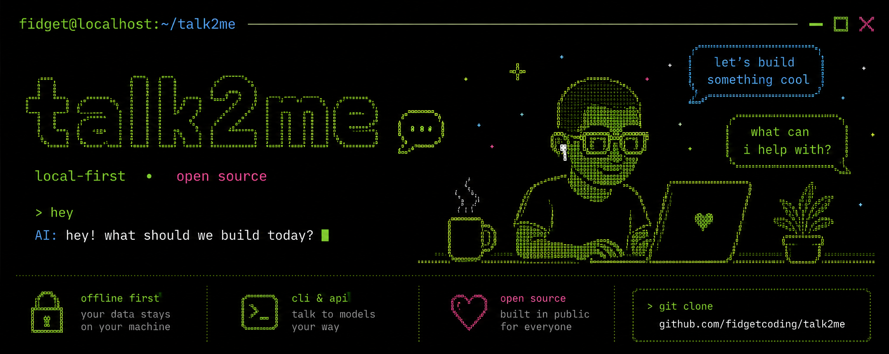
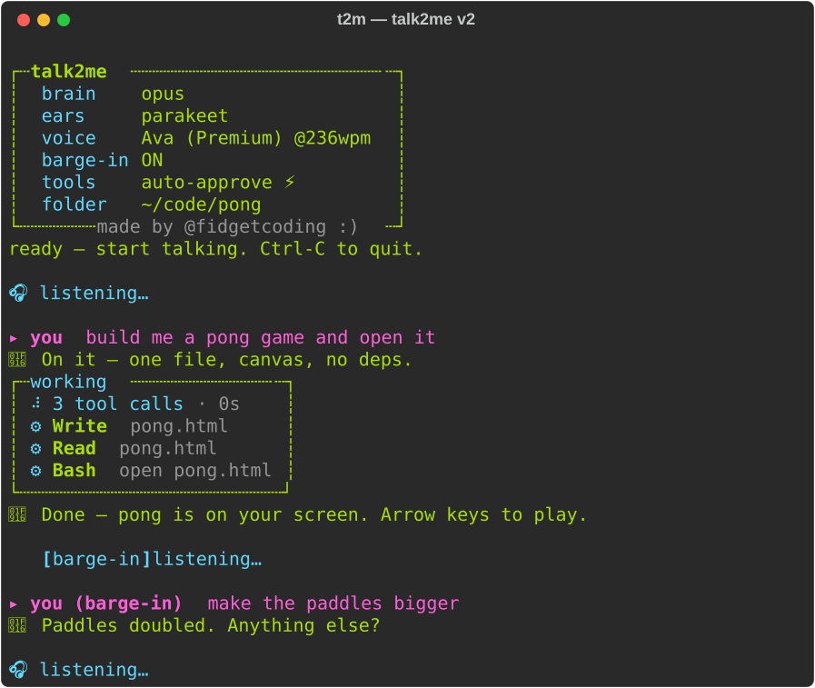

<div align="center">



</div>

# talk2me 

**Talk to your terminal. It talks back. Then it shuts up and listens again — no buttons, no holding a key like it's a walkie-talkie.**

You say something. It hears you, types it to your coding agent, reads the answer out loud, and reopens the mic on its own. That's the whole loop. You never touch the keyboard unless you want to.

**Want the real story?** [ESSENCE.md](ESSENCE.md) is the one-pager. [EVOLUTION.md](EVOLUTION.md) is the whole fight, with the rollback, the voice-lock bug and the audit that was right.

---

## Quick nav

| Start here | Talking to it | Make it yours |
|---|---|---|
| [Install (30 seconds)](#install-30-seconds) | [Reading the screen](#reading-the-screen-is-it-broken-or-is-it-waiting) | [Changing the voice](#changing-the-voice) |
| [**The cheat sheet**](#the-cheat-sheet) | [The new face (v2)](#the-new-face-v2) | [Switching the ears](#switching-the-ears) |
| [Quickstart](#quickstart) | [Saying yes out loud](#saying-yes-out-loud) | [Picking the brain](#picking-the-brain) |
| [Why I built this](#why-i-built-this) | [How long things take](#how-long-things-take) | [Saving your conversations](#saving-your-conversations) |
| [What it actually does](#what-it-actually-does) | [Interrupting it](#interrupting-it) | [Tuning the ears](#tuning-the-ears) |
| [The trick](#the-trick) | [Finish your sentence](#finish-your-sentence) · [Pausing the ears](#pausing-the-ears) · [🔒 Voice-lock](#voice-lock-only-you) | [The debugging playbook](#the-debugging-playbook) |
| [Requirements](#requirements) | [Hear Claude Code itself](#hear-claude-code-itself-hook-mode) · [📱 Phone mode](#phone-mode-ssh-from-your-iphone) | [Under the hood](#under-the-hood) |
| [Tests](#tests) · [FAQ](#faq) · [Versions](#versions) | [Ways to run it](#ways-to-run-it) | [Not done yet](#not-done-yet) · [How it evolved](#how-it-evolved) |

---

## Install (30 seconds)

One line, in any terminal:

```bash
curl -fsSL https://raw.githubusercontent.com/fidgetcoding/talk2me/v2.7.0/install.sh | bash
```

Then:

```bash
t2m
```

That's it. That's the command. Talk.

Want GPU ears on Apple Silicon baked in from the start? Same line, one flag: `--parakeet` for the fastest, `--whisper-gpu` for the big Whisper. Both are chunky dependency piles, so give it a few minutes:

```bash
curl -fsSL https://raw.githubusercontent.com/fidgetcoding/talk2me/v2.7.0/install.sh | bash -s -- --parakeet
```

Other ways in, if that's your style:

```bash
# pipx (isolated, on PATH, no thinking)
pipx install "git+https://github.com/fidgetcoding/talk2me.git@v2.7.0"

# plain pip, your venv, your rules
pip install "git+https://github.com/fidgetcoding/talk2me.git@v2.7.0"

# or from a clone
git clone https://github.com/fidgetcoding/talk2me.git && cd talk2me && pip install -e .
```

And the laziest path of all: paste this repo's URL into Claude Code and say *"install this."* You're about to have voice conversations with the thing — it can handle a pip install.

### First launch

A bare first `t2m` (no flags, no saved setup) walks you through it: pick the **brain** (Claude by default — or **Kimi, GLM, DeepSeek**, which run through the same agent via their official Anthropic-compatible endpoints with your API key; "opus 4.6" style shorthand works), the **ears** (whisper by default, or the GPU options on Apple Silicon; it offers to install what's missing), the **voice** (it recommends Ava (Premium) and tells you where to get her), **barge-in** (on, explained), **tools** (ask out loud first by default, auto-approve if you want it, both explained), and the **folder** you're working on. Answers save to `~/.talk2me/config.json` and become your defaults — flags always override. Change your mind any time: `t2m --setup`, or **Ctrl-T** mid-session (macOS) to reopen the menu without losing your place.

First run on macOS pops a **microphone permission** dialog for your terminal — click Allow, or you'll be talking to nobody.

**Pro tip:** when your agent is doing the installing, give it this repo's link too. It's open source — you can do whatever tf you want — and an agent that has read the source debugs your machine's quirks (weird audio devices, mic permissions, your cursed Bluetooth setup) in one turn instead of guessing.

### Versions

The installer grabs the newest tagged release, not whatever landed on `main` five minutes ago. Want the bleeding edge anyway? Add `--ref main`. **v2** is the same voice loop with a new retro face. **v1** is the launch build, frozen forever as the `v1` branch and the `v1.0.0` tag. If you liked it plain, it's one flag away:

```bash
curl -fsSL https://raw.githubusercontent.com/fidgetcoding/talk2me/v2.7.0/install.sh | bash -s -- --v1
```

Re-run the installer with a different `--ref` any time to switch versions in place. Pinning by pip works too: `pip install "git+https://github.com/fidgetcoding/talk2me.git@v1.0.0"`.

What changed from v1 to v2, in one glance:

- **The retro face** — banner, dotted config card, green/pink/cyan theme, live work panel, syntax-highlighted code cards, visible thinking. (`--plain` = the v1 look, kept forever.)
- **You can watch the work** — every file write, diff, and long command prints in the feed instead of hiding behind a tool counter.
- **Bring your own brain** — Claude by default; OpenAI's Codex CLI via `--agent codex`; Kimi/GLM/DeepSeek via their Anthropic-compatible endpoints. The wizard walks you through all of them.
- **Noise immunity** — a real speech classifier gates everything: typing, taps, and coughs can't fire turns or cut the agent off mid-answer anymore.
- **Barge-in is the default** — interrupting by talking just works, headphones or speakers (on speakers it filters its own voice out of the mic). `--no-barge-in` for the polite loop.
- **Pause got serious** — more wake/sleep vocabulary, works mid-task without cancelling the work, and the screen stays honest while asleep.
- **It remembers** — `t2m --continue` resumes this folder's last session, and saying "resume previous session" lists earlier ones by name to switch live.
- **Type when you want to** — paste logs or type exact paths mid-session; Enter sends. Voice and keyboard share one brain.
- **It hears you while it codes** — long tool runs reopen the ears in every gap instead of going deaf until the turn ends.
- **First-run setup wizard** — brain/ears/voice/barge/tools/folder, saved as defaults; `t2m --setup` or Ctrl-T to change.
- **📱 Phone mode** — `t2m --phone` over an SSH port-forward makes your iPhone the mic and speaker.
- **🔒 Voice-lock** — enroll once and the mic answers only to you; "team session" opens it up when you're not alone.

## The cheat sheet

Everything on one screen. This is the whole manual for day one.

**Things you SAY** (to the mic, mid-session):

| Say | When | What happens |
|---|---|---|
| *anything* | `🎧 listening…` is showing | It answers out loud, then listens again. That's the loop. |
| *anything* | it's mid-build (tools running) | The ears reopen during every tool stretch — even in half-duplex, long builds stay interruptible by voice. |
| *keep talking over it* | it's mid-answer (on by default, speakers included — it filters its own voice out of the mic) | Voice AND thinking stop; what you said becomes the next message. No magic word — any sustained speech cuts it. |
| **"pause listening"** · "stop listening" · "sleep" · "go to sleep" · "go to bed" · "take a break" · "pause" | any time — even mid-task | Ears go quiet until you wake it. Never cancels running work: an interrupted task auto-resumes. |
| **"wake up"** · "resume listening" · "I'm back" · "unpause" | while paused | Back to normal listening. |
| **"resume previous session"** · "continue previous session" · "list sessions" | while it's listening | Speaks a numbered list of this folder's earlier sessions (named by their first instruction) — say a number to switch the live conversation onto it, or "cancel". |
| **"approve"** · "yes" · "go ahead" / **"deny"** · "no" · "stop" | it asks "Approve or deny?" (the default, unless you chose auto-approve) | Runs or declines the tool call. Mumble twice = it declines for you. |
| **"team session"** · "everyone can talk" / **"solo session"** · "lock to my voice" | any time (voice-lock enrolled) | Opens the ears to everyone, or locks them back to your enrolled voice. |

*Every command in this table also works typed — same words, Enter instead of silence.*

**Things you TYPE:**

| Type | What you get |
|---|---|
| `t2m` (or `talk2me`) | The whole thing, defaults on. Talk. |
| `Ctrl-C` | Done. (Transcript, if enabled, is already saved — it writes live.) |
| *type anything + Enter* | Works mid-session, any time — your keystrokes get their own ⌨ line (inside the working panel too). Typed mid-work, Enter cuts in like a barge and your line becomes the next instruction. Multi-line pastes arrive as one message. |
| `pause` / `sleep` + Enter | **Every spoken command works typed too.** The whole "Things you SAY" vocabulary — pause, sleep, go to bed, take a break — same words, same result. Typed mid-build it flips the ears WITHOUT interrupting the work. |
| `wake up` / `unpause` + Enter | Wakes it from a typed or spoken pause. Also the universal unstick: typed input bypasses the audio gate entirely (voice-lock, noise, whatever — the keyboard always gets through). |
| `t2m --continue` (or `-c`) | Pick up where you left off — resumes this folder's last session, memory intact. No more "what game?". |
| `t2m --no-barge-in` | Turn interrupting OFF (barge-in is the default, speakers included). |
| `t2m --auto-approve` | Tools run with nobody asking. Fast, but anything the mic hears can start them. The default asks out loud first (`--gated`). See [Saying yes out loud](#saying-yes-out-loud). |
| `t2m --sandbox` | The OS keeps the agent to this project and the model API, so a script can't walk around the rules (macOS and Linux). `--sandbox-allow-host .npmjs.org` lets more through. |
| `t2m --stt parakeet` | The speed option: about 0.1s per sentence on the GPU, English-only (Apple Silicon; `pip install -e ".[parakeet]"` first). See [Switching the ears](#switching-the-ears). |
| `t2m --stt whisper-gpu` | The big Whisper on the GPU: large-v3-turbo, about 0.55s per sentence, ~2 GB RAM, 1.6 GB download on first use (Apple Silicon; `pip install -e ".[whisper-gpu]"` first). |
| `t2m --voice "Ava (Premium)" --rate 236` | A voice from this decade, at 1.35× speed. |
| `t2m --model haiku` | Cheap fast brain for casual chat; any `claude` model name works. |
| `t2m --agent codex` | OpenAI's Codex CLI as the brain (`codex login` first). Same voice loop, same feed; safety = Codex's own sandbox. |
| `t2m --backend-base-url … --backend-auth-env MY_KEY` | A different brain entirely — Kimi/GLM/DeepSeek publish Anthropic-compatible endpoints; the key stays in your env, never a file. Easiest via `t2m --setup`. |
| `t2m --language es` (or `auto`) | Talk to it in another language. CPU whisper moves from its English-only model to the multilingual one by itself, a one-time download. Parakeet is English-only. Voice commands come along for Spanish, French, German, Italian and Portuguese, and English always works. |
| `t2m --save-dir ~/talk2me-logs` | Every session saved as live-written markdown. |
| `t2m --plain` | The classic v1 look — no colors, no panels. (Auto-on for pipes, CI, and `NO_COLOR`.) |
| `t2m --no-speech-check` | Disable the "was that actually a human talking?" classifier (on by default; rejects typing, taps, coughs). |
| `t2m --phone` | Your iPhone becomes the mic + speaker over your SSH tunnel. See [Phone mode](#phone-mode-ssh-from-your-iphone). |
| `t2m --enroll-voice` | Voice-lock: a guided minute of enrollment (varied volumes/speeds); from then on the mic answers to YOUR voice only — other people, the TV, and its own speaker output get ignored. `--voice-lock` / `--no-voice-lock` toggles it. |
| `t2m --setup` | The guided setup menu — brain, ears, voice, barge-in, tools, folder. Saves as your defaults. |
| `Ctrl-T` (macOS, mid-session) | Reopen that settings menu without losing your place; relaunches with the new picks. |
| `t2m --version` | Which build you're on. |
| `t2m --debug` | See every ear-state + latency numbers. Run this your first session. |

Launch from the project folder you want it working on — the startup line confirms everything: model, ears, voice, barge, tools mode, directory.

## Why I built this

I live in Claude Code. All day, in the terminal, sometimes from my phone on the couch over SSH.

I already had half of a voice workflow: Wispr Flow gives me dictation, so my words get *in* fine. What I never had was the other half. The Claude app on my phone talks back. ChatGPT talks back. You say a thing, you hear a thing, the conversation has a pulse. My terminal? Silent. I'd dictate a prompt, then sit there reading a wall of text like it's 1997.

I wanted the full feedback loop — the thing the phone apps have — for my CLI: talk, *hear* the answer, and have it start listening again by itself. No push-to-talk, no reading. Nobody had built that for a terminal coding agent without scraping the screen like a raccoon going through a dumpster. So here we are.

## What it actually does

```
you talk  →  it finds where your sentence ends  →  transcribes it
          →  hands it to Claude Code  →  speaks the reply out loud
          →  reopens the mic  →  you talk again
```

It runs **full-duplex** by default — the mic stays hot while it talks, so you can cut it off mid-sentence. Headphones make that trivial (the mic never hears the TTS). Open-air speakers used to force a downgrade; now the **echo gate** covers them: talk2me records exactly what it's playing, subtracts that from what the mic hears, and only sound it *isn't making* can barge. No feedback spiral, no self-interruption — and no headphones requirement. `--no-barge-in` forces the polite half-duplex mode; `--no-aec` restores the old speakers behavior (ears muted while it speaks).

When it's your turn, it says so (`🎧 listening…`). When you're mid-thought, it waits. When you stop, it goes.

## The trick

Most voice wrappers read your terminal screen and try to guess what the agent said. That's brittle and it means they'll happily read every menu, spinner, and file path out loud.

talk2me doesn't do that. It runs Claude Code in a structured streaming mode and owns the pipe directly — it feeds your words in and reads clean events back out. So it only ever speaks the **actual answer**. The tool calls, the file diffs, the machinery — all of that shows up on screen but never gets read aloud. Your assistant sounds like a person, not a malfunctioning GPS narrating every turn.

That structured connection is the entire reason this works. It's the spine. Everything else is swappable parts hanging off it.

One consequence worth knowing: talk2me runs its **own** Claude Code session (a headless one it controls), not the pretty interactive UI. If what you want is voice *inside* the normal Claude Code interface, that exists too — see [Hear Claude Code itself](#hear-claude-code-itself-hook-mode).

## The new face (v2)

v2 dresses the whole session in the banner's palette — green prose, pink for you, cyan for the machinery, dotted borders:

<p align="center">
  
</p>

What changed beyond the paint:

- **You see the actual work.** Every `Write` shows the code it's writing, every `Edit` shows a `-`/`+` diff, every long `Bash` shows the full command — syntax-highlighted cards right in the feed, capped so a big file doesn't bury the conversation. `--plain` gets the same bodies as indented `│` lines.
- **The work panel.** While the agent runs tools, one live panel shows a spinner, the tool count, a running clock, and the last five tools **with what they touched** (`⚙ Write  pong.html`). When the agent starts talking again, the panel folds into a one-line receipt: `⚙ 9 tool calls · 42s`. No more line spam during long builds.
- **Thinking, visible.** When the model streams extended thinking, it shows up dim under a `🧠` — on screen, never spoken.
- **The launch banner.** Big block-letter TALK2ME in the brand green (skipped automatically on narrow terminals), and the startup card now shows both paths that matter: `working on` (the agent's folder) and `saves to` (your transcript folder).
- **Tool detail everywhere.** Tool lines carry their argument — the filename, the command, the pattern — on screen and in saved transcripts (`- 🔧 Write (pong.html)`).
- **Nothing else moved.** The voice loop, timing, and permissions are identical — the plain output still exists under `--plain`, is auto-selected for pipes/CI/`NO_COLOR`, and is what the tests pin.

Paranoid by design: agent and user text never passes through the styling engine's markup, so a reply containing `[red]` prints as five characters instead of turning your terminal red.

## Reading the screen (is it broken, or is it waiting?)

This is the section I wish every voice tool had. Voice interfaces fail silently — you talk, nothing happens, and you can't tell whether it's thinking, waiting for you, or dead. talk2me prints a marker for every state it's in. Learn these and you'll never wonder again:

| You see | It means | What to do |
|---|---|---|
| `(loading the ears…)` | Loading the transcription model. One-time, at startup, before the mic even opens. | Wait a few seconds. Don't talk yet. |
| `talk2me ready — start talking` | Mic is about to go live. | Talk whenever. |
| `(half-duplex: talking over the agent is ignored…)` | Interrupting is off this session — you passed `--no-barge-in` (or `--no-aec` on speakers). | Fine for most use. Relaunch without the flag to interrupt. |
| `📝 saving transcript to …` | `--save-dir` is on; the session is being written to that markdown file as it happens. | Nothing — that's your searchable record. |
| `🎧 listening…` | Your turn. The mic is hot and idle. | Say something. |
| `▶ speech` *(only with `--debug`)* | It heard you start talking. | Keep going. |
| `⏹ turn end: ~1950ms speech -> transcribing` *(debug)* | You stopped, the silence window elapsed, your words are being transcribed. | Nothing — the answer is coming. |
| `⏹ … ignored (too short)` *(debug)* | It heard a blip under ~250ms (a cough, a key-click) and threw it away. | Nothing. This is noise rejection working. |
| `⏹ … ignored (no sustained speech — taps/clicks…)` *(debug)* | A burst of transients (desk taps, typing) added up to enough total noise but never held a voiced run like a real word does. Dropped before transcription. | Nothing. Type away. |
| `(…waiting for the rest)` | **Not a bug. Not stuck.** Your sentence sounded unfinished ("so what do you call…"), so it's holding the turn and giving you up to ~6 seconds to keep going. It'll do this up to 3 times. | Finish your sentence. Or stay silent and it sends what it has. |
| `🗣 you: …` | What it heard, final. This is exactly what the agent receives. | If it's wrong, just say "no, I said…" — it's a conversation. |
| `(ignored — transcription noise)` | The transcript looked like a machine artifact (one word looped), not speech. Dropped. | Nothing — that's the noise filter working. |
| `⏸ paused — say 'wake up'…` | You voice-paused it. Hearing everything, sending nothing. | Say "wake up" / "I'm back" to resume. |
| `🤖` followed by streaming text | The agent is answering. Speech starts at the first clause, not the end. | Listen. |
| `🧠` followed by dim text | The model's extended thinking, streamed. Shown, never spoken. | Read along or ignore it. |
| A dotted card full of code | The actual work — file contents for `Write`, a `-`/`+` diff for `Edit`, long `Bash` commands. | Watch your code get written. |
| `[tool] Bash` etc. (v1 / `--plain`) — or the live `working` panel (v2) | The agent is using a tool. Shown, never spoken. Tool-heavy turns take longer before you hear anything. | Patience — watch the tools tick by. |
| `⚙ N tool calls · 42s` | The work panel folded into its receipt — the tool burst is over and the agent is talking (or done). | Nothing. |
| *a soft "tink" every ~8s* (only with `--ticks`) | The working tick: mid-tool-run and fine, just busy. OFF by default — the work panel shows the same thing silently. | Nothing. |
| `[permission] Bash: command=…` + a spoken question | The approval gate, on by default. The agent wants to run something and the turn is PAUSED until you answer. | Say "approve" or "deny". Unclear twice = auto-deny. |
| `[barge-in] listening…` | You talked over it (or something did). Playback and the agent's turn were cut; it's now collecting what you're saying. | Finish your sentence — it becomes the next message. |
| `[go on…]` | Same cut, but it happened before the agent said anything — it thinks you're still finishing YOUR sentence. | Keep talking; your fragments get stitched together. |
| `🗣 you (continued): …` | It stitched your interrupted sentence back together and sent the whole thing. | Nothing — this is the fix working. |
| `(noise interrupt — repeating your question)` | Something cut the turn but transcribed to nothing (a cough, a chair). It's re-sending your question instead of eating it. | Nothing. Self-healing. |
| `(resuming the interrupted task)` | You said "sleep"/"pause" while the agent was working. Ears are paused; the task was re-sent and continues. | Nothing — say "wake up" whenever. |
| `[t] stt / first-token / first-audio` *(debug)* | The latency receipts for the turn. | Use them when tuning; see the table below. |
| Long silence, no markers at all | NOW it might actually be stuck. | See [The debugging playbook](#the-debugging-playbook). |

The one-line version: **if the screen printed a marker recently, it's not broken — it's in whatever state the marker says.** The only bad state is no marker and no sound.

## How long things take

Measured on an M-series MacBook Pro, `--model haiku`, whisper base.en. Your numbers will vary; `--debug` prints yours per turn.

| Stage | Typical | The knob |
|---|---|---|
| You stop talking → turn ends | **1.2s** (fixed silence window) | `--silence-ms`. Lower = snappier but cuts off your thinking pauses. |
| Turn ends → transcript | 0.3–0.5s on base.en | `--stt parakeet` is the fast end, ~0.1s. |
| Transcript → first token | 1.3–2.5s (simple), 3–7s+ (tool-using turns) | Model choice. Tool turns are just slower — watch the `[tool]` lines. |
| First token → first sound | 1–2s (TTS render of the first clause) | Shorter first sentences start faster; a streaming TTS engine is the future fix. |
| **Total: silence → hearing the answer** | **~4–6s** simple, more with tools | |
| "Waiting for the rest" window | up to 6s per pause, ×3 | Fixed. Silence ends it early. |
| Interrupting it (barge-in) | cuts within ~0.5s of sustained speech | 450ms threshold — a cough won't trigger it, a sentence will. |
| An interruption's max length | 10s, then it processes what it has | So a rant can't wedge the loop. |

## Saying yes out loud

A coding agent isn't just chat — sooner or later it wants to *do* something. Run a command. Write a file. Here's how talk2me handles that, in both of its moods:

**The default: it asks first.** Anything outside a read-only allowlist pauses the turn and asks out loud:

> **it:** "Claude wants to run the command npm install. Approve or deny?"
> **you:** "go ahead"
> *…it runs, and the answer keeps going.*

Say "approve", "yes", "go ahead" — or "no", "stop", "deny". Unclear twice = it plays it safe and declines for you. Tired of blessing the same thing? `--allow-tool 'Bash(make:*)'`.

Why this is the default: a mic isn't a keyboard. It hears you, the TV, and your roommate reading a recipe, and Whisper will turn any of it into an instruction. Versions 2.2 through 2.5 defaulted to auto-approve anyway, and an audit called it out, fairly. So v2.6 flipped it. If you picked auto-approve in the wizard back then, your pick stands, and each launch reminds you in one line.

**The fast mode: `--auto-approve`** (or pick it in `t2m --setup`). Tools just run. You ask for a pong game, it writes the file, starts the server, tells you when it's playable, no "mother may I" at every step. It's the flow the phone apps taught you to expect, and I get why you'd want it. Know the deal: anything the mic picks up can start a command, with nobody asking.

**The denylist, in every mode.** `sudo`, recursive `rm`, `find -delete`, `git push`, `git reset --hard`, `curl`, `wget`, `ssh`, `scp`, `nc`, `dd`, one-liners like `python -c` and `bash -c`, and the absolute-path spellings of those: 69 rules, blocked outright, not askable, no voice override. Extend it anytime: `--deny-tool 'Bash(docker:*)'`.

Don't mistake it for a sandbox, though. It reads the command line, and there are endless ways to spell a command. Write a script and run it, make a git alias, copy a binary to a new name: all of that walks right past. I tested exactly this against the real CLI, and [SECURITY.md](SECURITY.md) has the honest list of what gets through. Want a real wall? `t2m --sandbox` has the OS enforce it: the agent can write only to the project and reach only the model API, so a script gets stopped by the kernel instead of by a pattern. It's off by default because `npm install` and friends then need `--sandbox-allow-host`, and it's macOS and Linux only. I tested it by running a hostile script at it, and [SECURITY.md](SECURITY.md#the-real-wall---sandbox) has what it stops and what it can't.

The startup line always tells you which mood you're in: `tools: gated (spoken approvals)` or `tools: auto-approve ⚡`.

(In `--text` mode nothing ambient can reach it, so typed input keeps auto-approve as its default. `--text --gated` gets you a plain `approve? [y/N]` prompt. And the only way to drop the denylist itself is `--dangerously-allow-tools`, which refuses to run in voice mode at all — a zero-guardrail posture should require a keyboard.)

## Interrupting it

Barge-in is **on by default** — for when the answer is long and you already know where it's going.

The mic stays hot while it talks. Start speaking and it stops mid-sentence — not just the voice, the *thinking*: the agent's turn is actually cancelled, and what you said becomes the next message.

Headphones or speakers, doesn't matter. On headphones the mic simply never hears the TTS. On open-air speakers (macOS), **native echo cancellation** takes over: the same driver-level canceller behind FaceTime subtracts everything the Mac is playing from the mic before talk2me ever sees it — its own voice can never cut it, yours always can, in a normal conversational tone. The startup card says so: `barge-in ON — speakers, native AEC`.

**The volume sweet spot: four volume-down clicks below max.** Field-tested — up to that level (~75%) it catches everything you say, talk-overs included, at couch volume. At flat-out max the speakers are simply overpowering the mic from inches away; raise your voice a touch mid-sentence, or speak in any pause (between sentences, during thinking or tool runs you're heard instantly at any volume).

If the native canceller isn't available (Linux, or it fails its startup probe), the v2.4 **echo gate** is the fallback: talk2me matches the mic against every sample it's playing and rejects anything the playback explains. Same idea, userspace, a little less headroom at high volume. `--aec gate|off` forces a layer. One blind spot either way: a *Bluetooth speaker* has an arbitrary name and passes for headphones, so neither layer arms there — if it argues with itself on one, pass `--no-barge-in`.

Know these three things and barge-in will never surprise you:

1. **There's no magic word.** "Stop" isn't special. ANY sustained speech (~half a second) cuts it — the whole sentence you said becomes the next instruction.
2. **It will cut on your mumbles too.** Think out loud near a hot mic and it'll stop talking and listen. That's the deal you signed.
3. **Interruptions cap at 10 seconds.** State your business; it processes what it has and moves on.

`--no-barge-in` gives you the polite half-duplex loop: it finishes, then listens. `--no-aec` keeps barge-in but restores the old speakers behavior (ears muted only while it speaks).

## Finish your sentence

Real people trail off. "So what do you call… uh…" *(three seconds of staring at the ceiling)* "…a group of crows?"

Old voice tools send the fragment, and the agent answers garbage. talk2me listens for whether your sentence *sounded finished* — the transcription engines actually signal this (they skip the final period when you trail off) — and holds the turn:

```
⏹ turn end: ~2370ms speech -> transcribing
   (…waiting for the rest)        ← it knows you're not done
  ▶ speech                        ← you kept going
🗣  you: So what do you call a group of crows?    ← ONE turn, stitched
```

You get ~6 seconds per pause, up to 3 pauses. Once you start talking again it always hears you out — the window only limits the silence, never cuts a started sentence.

## Pausing the ears

Someone walks in, the phone rings, you need to think out loud without a transcriptionist. Say:

> **"pause listening"** (or "pause", "sleep", "go to sleep", "go to bed", "stop listening", "take a break")

It confirms out loud, prints `⏸ paused`, and from then on it hears everything and sends **nothing** — no agent turns, no transcript entries, no reactions. Until you say:

> **"wake up"** (or "resume listening", "I'm back")

The commands only trigger as a complete utterance — saying "pause listening to him" mid-sentence won't trip it — and saying one **while the agent is mid-task** never cancels the work: the ears pause, the control word never reaches the agent, and if the interruption clipped a working turn, talk2me re-sends the task on its own (you'll see `(resuming the interrupted task)`). And a note for the observant: the mic hardware stays open while paused (that's how it hears "wake up"); "paused" means nothing leaves the loop, not that the microphone is off. Ctrl-C is the off switch.

Related: transcripts that look like machine noise (the same word looped five-plus times — a known transcription artifact on fan hum and silence) get discarded automatically with an `(ignored — transcription noise)` note, so phantom "Okay. Okay. Okay." turns never reach the agent.

## Voice-lock (only you)

Enroll once — `t2m --enroll-voice`, a guided minute of prompts at different volumes and speeds (loud, quiet, fast, slow, plus the actual command words) — and the mic answers to **your voice only**. Roommates, meeting audio, the TV, even its own voice out of the speaker: heard, checked against your voiceprint, ignored. The check runs AFTER the speech classifier, so it costs nothing extra on noise, and utterances too short to fingerprint reliably (a fast "wake up") always pass — wake words are never eaten.

Working with people? Say **"team session"** and the lock opens — everyone talks, everything else stays the same. **"solo session"** locks it back. The setup wizard asks about voice-lock too, and the startup card shows the mode.

(Speakers talk-over used to ride on the voiceprint; it doesn't anymore — the [echo gate](#interrupting-it) covers speakers for everyone, enrolled or not, deterministically. Voice-lock is purely about *who* gets listened to.)

One thing it won't stop: anything under 0.8 seconds always passes, because a fast "wake up" must never get eaten. So a short "approve" from someone else still lands.

Honesty corner: the enrollment calibrates its accept-bar against the agent's own TTS voice (the impostor that matters most) and warns you if the margin comes out thin. Speaker verification is probabilistic — a very similar voice may occasionally slip through or a bad mic day may make it doubt you. Re-enroll any time with `t2m --enroll-voice`; kill it any time with `--no-voice-lock` or "team session".

## Hear Claude Code itself (hook mode)

talk2me's main loop runs its own agent session. But maybe you *like* the regular Claude Code interface — the panels, the todo lists, your session history — and you just want the missing half: hearing the replies. (This was literally the original itch: Wispr for input, nothing for output.)

That's a one-file hook, and it ships in this repo:

```jsonc
// ~/.claude/settings.json — add to your hooks:
{"hooks": {"Stop": [{"hooks": [{"type": "command",
    "command": "python3 /path/to/talk2me/scripts/claude-speak.py", "timeout": 10}]}]}}
```

Every time Claude Code finishes a reply — in the real UI, your model, your session — the hook reads the transcript, strips the markdown, skips the code blocks ("code is on screen"), and speaks the reply.

It's **off by default** and gated by a toggle file, so background agents and scheduled jobs never start talking at 10 PM:

```bash
touch ~/.talk2me-speak     # voice ON  (new sessions)
rm ~/.talk2me-speak        # voice OFF
echo 'Ava (Premium)|236' > ~/.talk2me-speak   # ON, with a specific voice|rate
```

Replies over ~1200 characters get summarized to their first chunk plus "the rest is on screen." A new reply cuts off the previous one mid-sentence, like a person who has moved on.

Hook mode + Wispr (or any dictation) = full voice conversation inside the real Claude Code UI. talk2me's own loop = fully hands-free, mic and all. Pick per mood; they don't conflict.

## Phone mode (SSH from your iPhone)

You SSH into your machine from Blink (or any iOS terminal), run `t2m --phone`, and your **iPhone becomes the microphone and the speaker** — same loop, same barge-in, same pause words. The terminal stays your screen; the phone is just the ears and the mouth.

The trick: SSH can't carry audio, so the audio rides your SSH tunnel instead. talk2me serves a one-tap page on `localhost` only (never your network), and the phone reaches it through a port-forward:

1. In Blink, add a port forward to the host: `-L 8765:localhost:8765`
2. On the Mac (over SSH): `t2m --phone` (different port: `--phone-port 9000`, and match it in step 1 and 3)
3. On the phone, open the exact URL talk2me prints (it's `http://localhost:8765/?t=…` — the key in it is your session's lock) in Safari and tap connect

That's it. `localhost` counts as a secure context, so the mic works with zero certificates, everything is encrypted because it's literally inside your SSH connection, and the one-time key in the URL means no other process on either machine can pretend to be your microphone. Keep the Safari page open (it IS the audio hardware) — split it with Blink or glance between them; the conversation renders in the terminal as always.

Two details worth knowing: the phone's own echo cancellation is what makes barge-in workable on its bare speaker (it's been not-hearing-itself on calls for two decades — AirPods make it even better), and playback timing is honest — the loop reopens the mic when the **phone** finishes speaking, not when the Mac finishes sending.

## Quickstart

```bash
t2m
```

Start talking. Hit `Ctrl-C` when you're done. (`t2m` and `talk2me` are the same command — the short one exists because you'll type it a lot.)

One thing to expect the first time: when the agent wants to run or change something, it asks you out loud, so answer "approve" or "deny" (or take the training wheels off with `--auto-approve`).

One rule to internalize: **the agent works on whatever directory you launch from** — same as the `claude` CLI. `cd` into your project first (or pass `--cwd ~/some/project`), and the startup line confirms it: `working on: /path/you/meant`. Launch from your home folder and it'll happily rummage around your home folder.

No `--model` flag needed — it uses whatever your `claude` defaults to, same as the regular UI. Pass `--model haiku` when you're testing and don't want to spend real-model money on "count to fifty."

Got a favorite setup? Freeze it into an alias once and never think about flags again. Mine:

```bash
alias t2m='t2m --voice "Ava (Premium)" --input-device "MacBook Pro"'
```

No `--output-device` needed — sound follows whatever macOS is currently routed to (headphones when they're in, laptop speakers when they're not; barge-in works on both — [on speakers the echo gate filters its own voice](#interrupting-it)). Pinning the *input* to the laptop mic is the one worth keeping: it spares your Bluetooth headphones from dropping into telephone-quality mode.

## Changing the voice

The stock macOS voice works, but it's giving 2005. Two minutes fixes that:

1. **System Settings → Accessibility → Read & Speak** (called *Spoken Content* on older macOS).
2. Click the **ⓘ next to "System voice"** — that's the whole catalog, with ▶ preview buttons.
3. Download anything tagged **(Enhanced)** or **(Premium)** — **Ava (Premium)** is the crowd favorite; **Evan (Enhanced)** if you want a male voice. 100–500MB each.
4. Tell talk2me: `t2m --voice "Ava (Premium)"`.

Speed is separate: `--rate 236` is the default (~1.35× the sleepy stock pace), `--rate 260` if you like it brisk. You don't need to change the system voice setting itself — the flag is enough.

## Switching the ears

Three engines ship, one flag apart. **whisper with base.en is the default**, everywhere. The other two are opt-in, for Apple Silicon, and nothing extra gets installed or downloaded unless you ask for it.

| | **whisper** (default) | **whisper-gpu** | **parakeet** |
|---|---|---|---|
| Model | Whisper base.en | Whisper large-v3-turbo | Parakeet TDT v2 |
| Runs on | CPU, any Mac/Linux | Apple-Silicon GPU | Apple-Silicon GPU |
| Speed | ~0.46s | ~0.55s | **~0.11s** |
| Custom vocab (`--vocab`) | ✅ as hotwords | ✅ as a prompt | ❌ |
| Other languages | ✅ (a one-time extra download) | ✅ | ❌ English only |
| RAM while running | ~0.5 GB | ~2 GB | ~2 GB |
| Download | ~150 MB, once | 1.6 GB, once | ~600 MB+, once |
| Install | included | `pip install -e ".[whisper-gpu]"` (or the `--whisper-gpu` installer flag) | `pip install -e ".[parakeet]"` (or the `--parakeet` installer flag) |

```bash
t2m                    # whisper base.en
t2m --stt whisper-gpu  # the big Whisper, on the GPU
t2m --stt parakeet     # the fast ones
```

Asked for `whisper-gpu` where it can't run? It says so in one line and uses whisper. Same if it breaks mid-session, and you keep the sentence you were saying. Its first launch announces the 1.6 GB download, so it won't look hung.

### The numbers, and how much to trust them

I raced them: 24 clips, 8 coding sentences read by 3 voices ("Refactor useAuthStore so the orchestrator stops polling"), on one M2 Max.

| Engine | Median per clip | Worst | Word errors | ...with unrelated terms | ...with terms that match | What its misses look like |
|---|---|---|---|---|---|---|
| **whisper base.en, CPU (the default)** | **0.46s** | 0.60s | 12.5% | 13.2% | 7.3% | "use all stores", "piedest", "Superbase" |
| whisper large-v3-turbo, CPU | 6.17s | 6.43s | 11.2% | not run | not run | "use AuthStore", "PyTest", "SupaBaseEdge" |
| large-v3-turbo, GPU (`whisper-gpu`, optional) | ~0.55s | 0.7s, 1.1s when cold | 13.2% | 10.9% | 6.6% | "use AuthStore", "PyTest", "SupaBaseEdge" |
| parakeet v2, GPU (optional) | 0.11s | 0.27s | 13.2% | no vocab | no vocab | "use auth store", "super base" |
| parakeet v3, GPU | 0.12s | 0.13s | 14.5% | no vocab | no vocab | "use aut store", "py test" |

That's data, not a verdict, and here's the fine print:

- **Those voices are synthetic.** macOS `say` reading into a file, one Mac. [Real people](#on-real-people) are below, and they do reorder it. `python -m tests.manual_stt_bench` reruns the race if you want your own numbers. The latency holds up. The accuracy column is a hint at best, and real humans mumbling on a laptop mic may reorder it.
- **Those speeds are on a quiet Mac.** With other jobs grinding in the background, the same race came back around 1s for `whisper-gpu`, 0.66s for base.en and 0.31s for parakeet. The word errors didn't move.
- **Word-error rate can't see meaning.** It scores "use AuthStore" and "use all stores" the same way, and only one of those points a coding agent at the right thing. Read the misses column too.
- **Vocab moves the number, on both Whispers.** Same 24 clips, same terms: base.en takes them as hotwords, `whisper-gpu` as a prompt. Terms that match the sentences take base.en to 7.3% and `whisper-gpu` to 6.6%. That's a best case, because I handed them the answers. Terms that don't match, closer to everyday life, nudge base.en to 13.2% and `whisper-gpu` to 10.9%. Terms cost base.en a little speed (medians of 0.47 to 0.58s across two runs), and `whisper-gpu` held at 0.52 to 0.58s.

### On real people

macOS voices only tell you so much, so I also ran the ears on recordings of real people, from files. Two openly licensed sets, both [CC BY 4.0](https://creativecommons.org/licenses/by/4.0/), downloaded on first run and not stored in this repo:

- [LibriSpeech](https://www.openslr.org/12) dev-clean (Panayotov et al.): 40 volunteers reading audiobooks. 200 clips, 4,367 words.
- [Speech Commands](https://arxiv.org/abs/1804.03209) v0.02 test set (Warden, Google): people saying one word into their own laptop or phone. I scored 100 clips each of "yes", "go", "no" and "stop" on what the spoken gate would have done, plus 600 clips of other words that should do nothing.

| Engine | Word errors, sentences | Worst speaker | Gate got it right | Opposite verdict | False approvals (of 600) |
|---|---|---|---|---|---|
| **whisper base.en, CPU (the default)** | 5.6% | 20.4% | 92.5% | 0 | 6 |
| large-v3-turbo, GPU (`whisper-gpu`) | 3.5% | 11.7% | 93.0% | 0 | 1 |
| parakeet v2, GPU | 1.7% | 5.9% | 75.0% | 1 | 23 |

The rest of the time the gate heard nothing usable and asked again, which is the safe way to miss. Parakeet is the best listener on long sentences and the worst on one word, so think twice before pairing it with the spoken gate. Caveats: audiobook readers in quiet rooms aren't people talking to a laptop, there's no coding jargon in either set, and the gate clips are one word cut out of context. Rerun it with `python -m tests.manual_real_speech_bench --data <folder>`.

More engines can slide in the same way. Everything hides behind one contract, so adding one is a single file, and your muscle memory doesn't change.

## Picking the brain

The voice and the ears are local; the *thinking* is whatever Claude model you point it at — same `--model` flag as the `claude` CLI itself:

```bash
t2m                        # your claude default, whatever you've configured
t2m --model opus           # the heavyweight
t2m --model sonnet         # the daily driver
t2m --model haiku          # fast + cheap — great for testing and casual chat
t2m --model claude-opus-4-6   # pin an exact version if you're particular
```

Anything the `claude` CLI accepts works here, because it literally IS the `claude` CLI underneath. Rough guidance for a *voice* loop specifically: haiku answers fastest (nice when you're chatting), the big models think longer before the first word but are worth it when it's actually building something. Bake your pick into your alias next to your other flags and forget about it.

Model choice changes nothing else — same ears, same voice, same approval gate.

## Saving your conversations

By default, nothing extra is written. (Claude Code keeps its own machine-format transcript per session under `~/.claude/projects/…` — that's what powers `claude --resume`, and it's not fun to read.)

Point talk2me at a folder and every session also saves a **plain-markdown transcript** — what you said (including barge-ins and stitched continuations), what Claude answered, which tools ran, what you approved or denied:

```bash
t2m --save-dir ~/talk2me-logs            # this session

# or set it once and forget it — add to your shell profile:
export TALK2ME_SAVE_DIR="$HOME/talk2me-logs"
```

Files land as `t2m-2026-07-19-014212.md`, one per session, appended live (a crash loses nothing). If your notes live in Obsidian or any markdown vault, point it straight there and your voice sessions become searchable notes for free.

## Ways to run it

| Command | What you get |
|---|---|
| `talk2me` | Just talk. The main event. |
| `talk2me --text` | Type instead of talk — for when you're in public and not ready to be the person speaking to their laptop. |
| `talk2me --model sonnet` | Pick the Claude model, exactly like the `claude` CLI. See [Picking the brain](#picking-the-brain). |
| `talk2me --no-barge-in` | The polite loop: it finishes, then listens. (Interrupting is on by default.) |
| `talk2me --auto-approve` | Tools run with nobody asking. The default asks out loud first. See [Saying yes out loud](#saying-yes-out-loud). |
| `talk2me --debug` | Prints every ear-state and the per-turn latency receipts. Use this the first session, and any time something feels off. |
| `talk2me --voice "Ava (Premium)"` | A voice from this decade. Download it first: System Settings → Accessibility → Read & Speak → the ⓘ next to System voice → grab an (Enhanced)/(Premium) voice. |
| `talk2me --rate 260` | Talk faster (words/min). Default 236 ≈ 1.35× the macOS stock pace. |
| `talk2me --vocab Lorecraft --vocab Morgen` | Teach it your weird proper nouns so it stops inventing spellings. |
| `talk2me --stt parakeet` | The fast ears: Apple-Silicon GPU transcription, about 4× quicker than base.en on the same test. `pip install -e ".[parakeet]"` first. |
| `talk2me --stt whisper-gpu` | Whisper large-v3-turbo on the Apple-Silicon GPU. `pip install -e ".[whisper-gpu]"` first. |
| `talk2me --tts null` | Answers on screen, no voice out. |
| `talk2me --with-user-config` | Load your full user-level Claude config into the agent. Off by default because hooks and skills measurably slow every turn and their chatter gets read aloud. Project CLAUDE.md always loads. |

The rest of the knobs, for completeness: `--cwd` (which directory the agent works in — defaults to where you launched), `--vocab-file terms.txt` (bias terms in bulk, one per line), `--whisper-model small.en` (bigger whisper = better ears, slower), `--vad-aggressiveness 3` (webrtc noise filtering, 0–3), and `--dangerously-allow-tools` (auto-approve everything — **text mode only**, refused in voice mode on purpose: ambient audio should never carry that much power).

## The debugging playbook

Everything below actually happened while building this. If your session misbehaves, it's probably one of these — in rough order of likelihood:

**It never hears me at all — no `▶ speech` ever.**
macOS mic permission. The first run should pop a permission dialog for your terminal app; if you missed it: System Settings → Privacy & Security → Microphone → your terminal → on. Then restart talk2me. Still nothing? `talk2me --list-devices` and check the `*` is on the mic you're actually talking into, then `--input-device "MacBook"` (name substring works).

**I talk over it and nothing happens.**
Check the startup card first: `barge-in off` means `--no-barge-in` was passed; `gaps only` means `--no-aec` on speakers. On speakers, check the volume: the sweet spot is **four volume-down clicks below max** — above that the speakers overpower the mic and a couch-voice talk-over can drown (raise your voice, or speak in any pause). On the echo-gate fallback (`ON — speakers` without "native AEC"), talk a full sentence at normal volume — the gate needs enough of you over its voice to tell you from its own echo. If you run through a shell alias, an open terminal doesn't reload edited aliases — `source ~/.zshrc`, then check the card again.

**It cuts itself off / interrupts on nothing / stops mid-answer.**
The mic is hearing its own voice without the echo gate armed — usually a Bluetooth *speaker* the device heuristic read as headphones, or headphones on the desk instead of on your head. Wear the headphones, or pass `--no-barge-in`. On the built-in speakers this shouldn't happen at all (the gate filters its own playback); if it does, run `--debug` and send the `(barge onset rejected — my own echo …)` / residual numbers upstream.

**It cuts me off mid-sentence when I pause to think.**
Raise `--silence-ms` (default 1200). And note the fallbacks already working for you: unfinished-sounding sentences get the `(…waiting for the rest)` hold, and if it does send early and you keep talking, the fragments get stitched (`you (continued):`).

**Bluetooth audio sounds like a telephone from 1995.**
The classic Bluetooth trap: using a BT headset's *microphone* forces the whole headset into telephone-quality mode. Split the devices — `--output-device "AirPods" --input-device "MacBook"` — and you get full-quality audio out with the laptop mic in. (Your AirPods show up under whatever name you gave them. Mine are "Megapods".)

**Every turn is slow and it recites my global config / says weird meta things.**
That was hook and CLAUDE.md inheritance — fixed by default now (the agent loads only project-level config; measured: it halved time-to-first-token). If you passed `--with-user-config`, that's the tradeoff you opted into.

**It answered but I hear nothing, screen looks fine.**
Wrong output device (check `--output-device` / `--list-devices`), or macOS routed audio elsewhere when a BT device connected mid-session. Restart talk2me after changing audio devices — PortAudio's device list is a snapshot.

**First utterance after startup takes forever.**
It shouldn't anymore — the model loads before the mic opens (`(loading the ears…)`). If you see that line for more than ~10s on parakeet, it's downloading the model from Hugging Face (first run only, ~600MB+). `--stt whisper-gpu` announces its own download (first use only, about 1.6 GB), and right after installing it, its first launch can sit for up to a minute while the new libraries load for the first time.

**The count-to-fifty test sounds mushy.**
Digit runs at speed are the hardest thing you can ask a TTS voice to say. The stock voice garbles them; a Premium voice (Ava) mostly doesn't. This is a voice-quality ceiling, not a bug — the streaming-TTS engine on the roadmap is the real fix.

**How do I know it's actually broken?**
No new marker on screen, no sound, for longer than the timing table says it should take — *and* you're not in a `(…waiting for the rest)` or `[permission]` state. Then: Ctrl-C (twice if needed), rerun with `--debug`, reproduce, and read the last marker printed — that's the state it died in. The `[t]` lines tell you which stage ate the time.

## Tuning the ears

The default mic settings assume a quiet room and a close mic. If it keeps cutting you off, or won't trigger at all, turn two knobs:

```bash
talk2me --debug --energy-threshold 0.02   # higher = needs you louder (kills background noise)
talk2me --debug --silence-ms 1500          # higher = waits longer before deciding you're done
```

Run with `--debug` while you tune. You'll see exactly when it thinks you started and stopped, so you're adjusting on evidence instead of vibes.

## Under the hood

Every swappable part hides behind a contract: voice detection, transcription, the voice it speaks in, and the agent on the other end. Want a better transcriber or a different voice? That's one new file, not a heart transplant. The main loop never even knows it changed.

Out of the box:

- **Ears (voice detection):** a simple loudness check by default — good enough for a quiet room, and the RIGHT pick under native AEC (the voice processor's noise floor reads as speech to webrtc, so native mode auto-swaps webrtc back to energy with a note). Off native mode, two sharper options ship: `--vad webrtc` (install with `pip install -e ".[webrtc]"`) holds up much better across mics, especially Bluetooth; `--vad silero` runs a small neural model (needs `pip install onnxruntime` plus the [silero_vad.onnx](https://github.com/snakers4/silero-vad) model file). Separately from the pick, every utterance must also convince a bundled Silero speech CLASSIFIER before it can interrupt or be transcribed — that's the layer that makes typing, taps, and coughs invisible (`--no-speech-check` to disable).
- **Transcription:** Whisper base.en, running on your CPU through faster-whisper. No cloud, no per-minute meter. Two opt-ins for Apple Silicon: `--stt whisper-gpu` is large-v3-turbo on the GPU through mlx-whisper, and `--stt parakeet` is NVIDIA's Parakeet on the GPU, fastest, English-only, no `--vocab`. Same contract for all three. One `whisper-gpu` quirk worth knowing: turbo's no-speech detector read zero on everything I tried through MLX, so left alone it answers silence with "Thank you." Every utterance passes a Silero check first, and silence stays silent. [The race results](#the-numbers-and-how-much-to-trust-them) are above; the original research lives in `docs/stt-upgrade-research.md`.
- **The mouth:** macOS `say`, rendered a chunk ahead of playback so the voice doesn't stall between sentences. `--tts kitten` (install with `pip install -e ".[kitten]"`) is a local neural voice that works on any OS. `--tts null` keeps it text-only.
- **The agent:** Claude Code by default, over its structured streaming interface — including the tool-permission wire behind the spoken approval gate (pinned byte-for-byte in `docs/permission-spike-results.md`). `--agent codex` swaps in OpenAI's Codex CLI (one `codex exec` per turn, resumed between turns — schema pinned live in `tests/test_codex_translate.py`). Kimi, GLM, and DeepSeek ride the Claude pipe via their official Anthropic-compatible endpoints (the wizard sets it up). Anything else hides behind the same one-file contract (`AgentBackend`) — fork away; that's what the MIT license is for.
- **The brain-to-ear glue:** after every reply, the identifiers the agent just used (file names, function names) get fed to the transcriber as bias terms — because those are exactly the words you're about to say back.

## Not done yet

Being honest about the edges, because shipping half-true READMEs is how trust dies:

- **A streaming voice.** `say` renders a chunk at a time, so the voice still restarts at chunk boundaries and you can hear the intonation reset on long lists. I got the dead air out: chunks now render side by side, and sentences that are already waiting render together. Measured on files with a fake speaker, on a typical 10-sentence reply, the worst stop went from 380 to 880 ms down to 16 ms or less, and restarts went from 9 to 4 or 5 (`python -m tests.manual_voice_gap_check`). I haven't heard it through real speakers yet. A neural streaming TTS (Kokoro is the candidate) would remove the restarts altogether.
- **Wispr hands-free.** I want to drive the dictation app I actually like instead of the basics. It's a real maybe — the keypress trick it needs isn't proven yet.
- **The echo-gate fallback is young.** On macOS the native canceller carries speakers talk-over now, but wherever the fallback gate runs (Linux, `--aec gate`), its residual threshold was tuned on synthetic fixtures plus one laptop — a very reverberant room may need the bar moved. `--debug` prints the residual on every rejected onset so tuning is evidence, not vibes.
- **Linux with a real mic.** CI now runs the real loop on Linux through real PortAudio and PulseAudio with virtual sound cards: a clip played into a fake room comes out of the fake mic, goes through the speech gate, base.en and the spoken approval, and its voice lands on a fake speaker, barge-in and pause included (`tests/live_linux_audio_check.py`). It even caught a real crash on Ctrl-C. But nobody has talked to it on Linux with an actual mic in an actual room, and real drivers are where the surprises live.
- **Phone mode on a real iPhone.** It's still never been driven from real hardware or a real Blink tunnel. Everything short of that now runs in CI: the real page in Chromium with an iPhone's screen and user agent, a fake mic fed from a file, through a real `ssh -L` tunnel into real base.en, the reply playing through the page's own code, plus reloads, wrong tokens, a talk-over, and a flaky network from a simulated phone. Safari's own engine (WebKit's Linux build) loads the page, takes the tap and connects, but it has no fake mic to feed, so it sent zero audio frames and the mic path has never run in WebKit. What only an iPhone can answer: iOS's audio session and autoplay rules, its echo cancellation, and what a locked screen or an incoming call does.
- **`whisper-gpu` on a real voice.** It has only heard files so far: the synthetic-voice race, spoken-command clips, and those same files replayed through the full loop with a fake mic, spoken "approve" and "deny" included. It hasn't been through a real mic in a real room, which is one reason it's opt-in.
- **Voice commands in other languages are young.** Spanish, French, German, Italian and Portuguese work now, typed or spoken, with `--language`. On files read by synthetic voices, single command words landed 68 of 80 times on `--whisper-model base` and 72 of 80 on `whisper-gpu` (it was 35 of 80 before I started feeding the engines those words as hints). Very short words are the hard part: "oui" and "no" still get lost, and a miss just means it asks again. No real accents tested, nothing past those five languages, and its own spoken replies ("Approve or deny?") are still English.
- **Voice-lock on a real laptop.** For three versions this mostly just observed, because it kept failing to tell people apart. I'd blamed laptop mics. It turned out I'd been feeding the speaker model the wrong features: it was trained with mean-normalized input, and an early spike wrongly talked me out of that. Fixed. On 40 real speakers from recordings (LibriSpeech), through a simulated laptop room, it went from enforcing for 4 of them to 39, and from letting 93.5% of strangers through to 6.3%, while rejecting its owner 9.2% of the time, mostly on 1 to 1.5 second clips. On the clean recordings: 2.2% of strangers, 0.5% of owners (`python -m tests.manual_voicelock_bench --data <folder>`). A simulated room isn't a real one, and it still hasn't met a real laptop mic. If you enrolled before this fix, your old print keeps working the old way until you run `t2m --enroll-voice`, and it tells you so at launch.

## The road here

The short version of a long fight with physics:

- **v1.0.0** — the proof. Half-duplex voice loop around a terminal coding agent: talk, it answers, the mic reopens. No push-to-talk.
- **v2.0.0** — the face. Work panels, code cards, the retro skin.
- **v2.1.0** — the polish wave. Setup wizard, phone mode, noise gates, pause/wake.
- **v2.2.0** — the keeper. Session continuity with a spoken picker, the Codex brain, typed input. This stayed the public release while the echo war raged below.
- **v2.3.0** — voice-lock. Only-you speaker verification, fully local. Shipped, then field-tested into observe-only: on a laptop mic, your own voice scatters wider than the gap to a stranger's. An honest loss — the scores still log, the idea still stands.
- **v2.4.0** — the echo gate. Speakers talk-over without headphones, by matching the mic against the exact playback. Zero false cuts in the field — but a couch-voice talk-over lost the volume war near max. Kept as the fallback layer.
- **v2.5.0** — the one we were chasing. macOS's own echo canceller (the FaceTime one) cleans the mic at the driver: its own voice comes out unintelligible to the transcriber at any volume, so you just talk. Plus the ⌨ input line — type at it while it works and it cuts in like a barge — and snappier pause/wake.
- **v2.6.0** is better manners. Voice stops auto-approving tools: a safety audit flagged it, it was right, and now it asks out loud unless you say otherwise. The denylist grew from 8 rules to 69 after I tested the old one against the real CLI and watched `rm -fr` stroll past. The installer pins to release tags instead of `main`. And [a race on 24 clips](#the-numbers-and-how-much-to-trust-them) got written down: base.en stays the default, Whisper large-v3-turbo on the Apple-Silicon GPU joins as the opt-in `--stt whisper-gpu`.

- **v2.7.0** is me going after everything on my own "isn't proven" list. An OS sandbox (`--sandbox`), so a written script can't walk past the rules. Voice-lock finally enforces, after I found the bug that had it observing for three versions. Voice commands in five more languages. The dead air between the default voice's chunks is gone. CI now drives the live mic loop on Linux with virtual sound cards, the headless suite on Windows, and the phone page in real browsers over a real SSH tunnel, and those runs found real crashes. And the ears finally got tested on real people. A real mic and a real iPhone are still on me.

That's the destination we set out for: a voice loop you can talk over, type over, and trust on open speakers. It got there. What's in [Not done yet](#not-done-yet) is real, mapped, and none of it is a mystery — the seams were built for this (swap a VAD, an STT, a TTS, a whole agent backend, or the renderer without touching the loop). **The rest is for the community to keep evolving.** Fork it, gut it, teach it new tricks — PRs and weird ideas welcome.

## How it evolved

The README tells you where this landed. The receipts live in `docs/`, warts included, and a couple of them argue with decisions I made later:

- **[EVOLUTION.md](EVOLUTION.md):** the full story, dated round by round.
- **[The security audit](docs/security-audit.md):** the original threat model, RCE by sound. It told me not to make bypass the default. I did anyway for a few versions, and the note in there says how that went.
- **[SECURITY.md](SECURITY.md):** where the posture stands today, including what the denylist can't do.
- **[The permission spike](docs/permission-spike-results.md):** the tool-approval wire pinned byte by byte, plus the denylist tested against the real CLI, what stopped and what didn't.
- **[The permission design](docs/permission-handling-design.md):** how the spoken gate got designed before any of it worked.
- **[The denylist spike](docs/permission-spike-results.md#denylist-spike-2026-11-01-claude-cli-21296)** is why the sandbox exists: what a pattern can't stop.
- **[The STT research](docs/stt-upgrade-research.md):** how to chase Wispr Flow quality locally, and why term accuracy matters more than pretty punctuation when the reader is a coding agent.
- **[The AEC plan](docs/v2.5-aec-plan.md):** the long fight with physics, from echo gate to macOS's own canceller, phases and field protocol included.
- **[Performance notes](docs/perf-notes.md), [architecture assessment](docs/architecture-assessment.md), [code review](docs/code-review.md), [integration plan](docs/integration-plan.md), [retro skin plan](docs/retro-skin-plan.md), [Wispr spike](docs/wispr-spike.md):** the rest of the paper trail.

And the 9 tagged releases, if you want to run the past: [v1.0.0](https://github.com/fidgetcoding/talk2me/releases/tag/v1.0.0), [v2.0.0](https://github.com/fidgetcoding/talk2me/releases/tag/v2.0.0), [v2.1.0](https://github.com/fidgetcoding/talk2me/releases/tag/v2.1.0), [v2.2.0](https://github.com/fidgetcoding/talk2me/releases/tag/v2.2.0), [v2.3.0](https://github.com/fidgetcoding/talk2me/releases/tag/v2.3.0), [v2.3.1](https://github.com/fidgetcoding/talk2me/releases/tag/v2.3.1), [v2.5.0](https://github.com/fidgetcoding/talk2me/releases/tag/v2.5.0), [v2.6.0](https://github.com/fidgetcoding/talk2me/releases/tag/v2.6.0), [v2.7.0](https://github.com/fidgetcoding/talk2me/releases/tag/v2.7.0). (v2.4.0 never got its own tag; the echo gate lives in v2.5.0's history.) `./install.sh --ref v2.3.1` puts any of them on your machine.

## Requirements

Everywhere:

- **`claude`** on your PATH (or `codex`, if you run `--agent codex`).
- **Python 3.11+**
- **A microphone**, ideally close to your face.

**macOS** — the platform this is built and daily-driven on. `pip install -e .` is all the setup there is: the audio library ships with PortAudio bundled, and the default voice is the built-in `say`. The optional `whisper-gpu` extra wants macOS 13 or newer, because MLX publishes nothing older.

**Linux**: CI drives the live loop end to end on virtual sound cards, and the headless suites pass. No human has used a real mic on it yet. What's known:

- PortAudio is not bundled on Linux — install the system library first: `sudo apt-get install libportaudio2` (Debian/Ubuntu) or `sudo dnf install portaudio` (Fedora). It sits on top of ALSA/PulseAudio/PipeWire, whichever you have.
- There is no `say` on Linux. Install `espeak-ng` and talk2me uses it automatically: it sounds like a robot, and it's one `apt-get` away. Otherwise pick a voice with `--tts kitten` (local neural voice, `pip install -e ".[kitten]"`) or `--tts null` (answers stay on screen). With none of those, the default voice degrades to silence rather than erroring.
- Whisper transcription and the `--text` mode are plain CPU Python and work as-is.

**Windows**: CI now runs every headless suite on a Windows runner, plus the real `python -m talk2me` through real pipes with a stand-in `claude.cmd`. That turned up real bugs, now fixed: it crashed importing a Unix-only terminal module, couldn't find an npm-installed `claude`, and died on `--vocab-file`. So `--text` works there. What it doesn't prove is anything about a live mic. The runner has no sound hardware, nobody has talked to it on Windows, and there's no built-in voice (`--tts kitten` should work; `--text` is the path I'd trust). `--sandbox` refuses to start on Windows.

## Tests

Plain scripts. No frameworks to install. The whole loop is tested without a mic and without spending a cent on the agent:

```bash
python -m tests.test_segment        # the part that finds where your sentence ends
python -m tests.test_loop_offline   # the full conversation, faked end to end
python -m tests.test_permission     # the spoken approve/deny gate, all paths
python -m tests.test_mlx_whisper    # the opt-in GPU ears with a fake model: one thread, the silence guard, every road to the fallback
python -m tests.test_barge_in       # interrupting it mid-sentence
python -m tests.test_echogate       # speakers talk-over: its own echo never cuts, you always can
python -m tests.test_continuation   # "wait, I wasn't done" stitching
python -m tests.test_flow           # run-on speech chunking + unfinished-sentence holds
python -m tests.manual_backend_check  # one real cheap turn against Claude Code
python -m tests.manual_denylist_check # the denylist against the real `claude`, no model, no cost
python -m tests.manual_stt_bench      # the ears race: real latency, synthetic voices, from files
python -m tests.manual_real_speech_bench --data <folder>  # the same ears on recordings of real people
```

That's the highlight reel — 27 suites total (renderer byte-parity snapshots, the retro skin's markup-injection defense, the phone bridge driven by a real WebSocket client, the setup wizard's config plumbing, the Codex event translator against live-captured lines, audio devices, sentence chunking, and more), and CI runs every one of them on three Python versions per push, and on Windows.

What those can't tell you is how well it actually hears, because the fake transcriber always gets it right. That part got measured separately, on real audio from files: see [the numbers](#the-numbers-and-how-much-to-trust-them), and the caveat that goes with them. `manual_denylist_check` is worth rerunning after a `claude` upgrade, since how the rules match is the CLI's call, not mine. Nothing in any of this opens your mic or speakers.

## FAQ

**Will it read my secrets out loud?**
No. It only speaks the assistant's actual sentences. The boring machinery stays silent and on the screen.

**Why does it run its own session instead of living inside the normal Claude Code UI?**
Because the interactive UI has no programmatic way in, and screen-scraping it is exactly the brittleness this project exists to avoid. The structured pipe is the reliable path — and for the "I just want the real UI, plus sound" case, [hook mode](#hear-claude-code-itself-hook-mode) does that.

**Does it work on Windows or Linux?**
The default voice is Mac-only (`say`), but `--tts kitten` is a local neural voice that runs anywhere. Windows passes the headless tests and `--text`, and nobody has tried a mic on it. On Linux you also need the system PortAudio library for the mic — see [Requirements](#requirements). Fair warning: the Linux mic loop is tested on virtual sound cards in CI, not by a human with a mic.

**Why not just type?**
Because my hands are busy and my mouth isn't.

**Is this going to hear my roommate and start talking to Claude?**
Typing, taps, coughs, and fan hum — no: a real speech classifier gates every utterance now. An actual human voice at conversation volume: yes, unless you enroll [voice-lock](#voice-lock-only-you), and even then treat it as a filter. On recordings through a simulated laptop room about 6% of strangers still got through, anything under 0.8 seconds always passes, and if its calibration comes out weak it only observes. Without it: "pause listening", or `--energy-threshold` up. And without it the spoken gate can't tell voices apart either, so your roommate can say "approve" too, and don't run this next to a prankster.

**Can the brain be something other than Claude?**
Yes — `--agent codex` runs OpenAI's Codex CLI, and Kimi / GLM / DeepSeek plug in through their official Anthropic-compatible endpoints (`t2m --setup` walks you through it). Same loop, same feed, different mind.

---

Built by [Nate](https://github.com/fidgetcoding) under the fidgetcoding flag. MIT licensed — take it, break it, make it weirder.

Built by directing Claude Code. Every decision and every live test is mine. The code is mostly its.

[MIT](LICENSE).
